# Mapeo del Diagrama de Clases UML hacia la Arquitectura de Microservicios

**Sistema:** SGAU / SIGA UNJBG (Monorepo `sgau-unjbg-system`)  
**Asignatura:** Base de Datos II / Ingeniería de Software

---

## 1. Mapeo de Clases de Dominio a Microservicios Upstream

| Microservicio / Módulo | Clases del Diagrama de Clases UML | Tablas SQL / Persistencia | Responsabilidad Principal |
|---|---|---|---|
| **`auth-service`** (M1, M2) | `Usuario`, `Rol`, `Auditoria`, `EstadoUsuario` | `roles`, `usuarios`, `auditoria` | Autenticación JWT, control de 3 intentos fallidos (RN-15), RBAC y bitácora inmutable (RF-55). |
| **`student-service`** (M3) | `Estudiante`, `FichaMedica`, `ResolucionEstudiante`, `EstadoAcademico`, `TipoResolucion` | `estudiantes`, `ficha_medica`, `resoluciones_estudiante` | Código AAAA-NNNNNN (CU-09/RN-01), Kardex (CU-11), aptitud médica (CU-23/CU-46) y verificación de graduación SUNEDU. |
| **`academic-service`** (M4) | `Facultad`, `EscuelaProfesional`, `PlanEstudio`, `Curso`, `MallaCurricular`, `Prerrequisito`, `PeriodoAcademico` | `facultades`, `escuelas_profesionales`, `planes_estudio`, `cursos`, `mallas_curriculares`, `prerrequisitos`, `periodos_academicos` | Malla por ciclos, validación de grafos acíclicos de prerrequisitos (CU-16) y apertura/cierre de semestres (CU-18). |
| **`schedule-service`** (M7) | `Aula`, `Seccion`, `HorarioSeccion`, `TipoAula`, `TurnoEnum`, `DiaSemana` | `aulas`, `secciones`, `horarios_seccion` | Aforo físico, solapamiento horario (CU-27/RN-04) y cupos por aula y docente. |
| **`enrollment-service`** (M5, M6) | `ColaMatricula`, `Matricula`, `DetalleMatricula`, `ExcepcionMatricula`, `EstadoCola`, `TipoMatricula`, `EstadoMatricula` | `cola_matricula`, `matriculas`, `detalle_matricula`, `excepciones_matricula` | Motor ACID de reservas y confirmación (CU-23), límite de 22 créditos y cola virtual en memoria/Redis (CU-38, CU-40). |
| **`finance-service`** (M8) | `ConceptoPago`, `DeudaEstudiante`, `Pago`, `Comprobante`, `TipoConcepto`, `EstadoDeuda`, `MetodoPago`, `TipoComprobante` | `conceptos_pago`, `deudas_estudiante`, `pagos`, `comprobantes` | Aranceles TUPA (CU-43), recaudación ventanilla (CU-45), serie/correlativo B001 y firma QR fiscal (CU-47). |
| **`rectification-service`** (M10) | `Rectificacion`, `DetalleRectificacion`, `EstadoRectificacion`, `TipoMovimiento` | `rectificaciones`, `detalle_rectificacion` | Simulación sin persistencia de altas/bajas/cambio de sección (CU-66) y emisión de acta oficial REC-2026-XXXX (CU-72). |
| **`reporting-service`** (M9) | `ActaEvaluacion`, `NominaSeccion`, `MetricaAcademica` | Consultas analíticas y reportes consolidados | Generación de actas oficiales con hash SHA-256 (CU-52), nóminas de sección (CU-51) y analítica gerencial. |

---

## 2. Diagrama de Arquitectura de Microservicios y Clases

```mermaid
graph TD
    ClientEst[Portal Estudiante SPA] --> Gateway[API Gateway :8000]
    ClientAdmin[Portal Admin Backoffice SPA] --> Gateway

    subgraph Microservicios Upstream
        Gateway --> AuthSvc["auth-service :3001<br/>(Usuario, Rol, Auditoria)"]
        Gateway --> StudentSvc["student-service :3002<br/>(Estudiante, FichaMedica, Resolucion)"]
        Gateway --> AcademicSvc["academic-service :3003<br/>(Facultad, Escuela, Plan, Curso, Periodo)"]
        Gateway --> ScheduleSvc["schedule-service :3004<br/>(Aula, Seccion, HorarioSeccion)"]
        Gateway --> EnrollSvc["enrollment-service :3005<br/>(ColaMatricula, Matricula, DetalleMatricula)"]
        Gateway --> FinanceSvc["finance-service :3006<br/>(ConceptoPago, DeudaEstudiante, Pago, Comprobante)"]
        Gateway --> ReportSvc["reporting-service :3007<br/>(ActaEvaluacion, Nomina)"]
        Gateway --> RectSvc["rectification-service :3008<br/>(Rectificacion, DetalleRectificacion)"]
    end

    subgraph Paquetes Compartidos
        Dtos["@sgau/common-dtos<br/>(Entidades y Enums del Dominio UML)"] -.-> AuthSvc
        Dtos -.-> StudentSvc
        Dtos -.-> AcademicSvc
        Dtos -.-> ScheduleSvc
        Dtos -.-> EnrollSvc
        Dtos -.-> FinanceSvc
        Dtos -.-> RectSvc
        Dtos -.-> ReportSvc
        DBClient["@sgau/database-client"] -.-> AuthSvc
        DBClient -.-> StudentSvc
        DBClient -.-> AcademicSvc
        DBClient -.-> ScheduleSvc
        DBClient -.-> EnrollSvc
        DBClient -.-> FinanceSvc
        Events["@sgau/event-contracts"] -.-> EnrollSvc
    end
```

